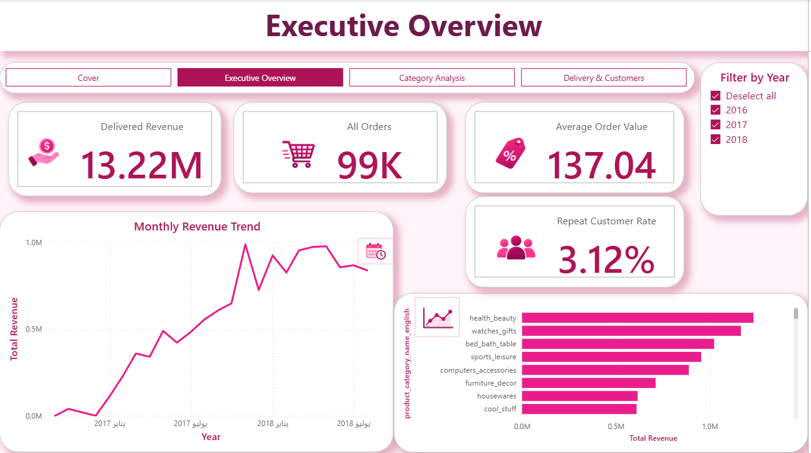
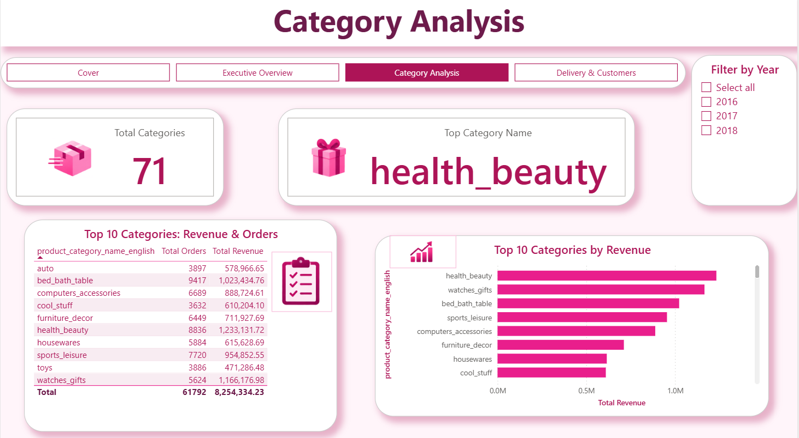
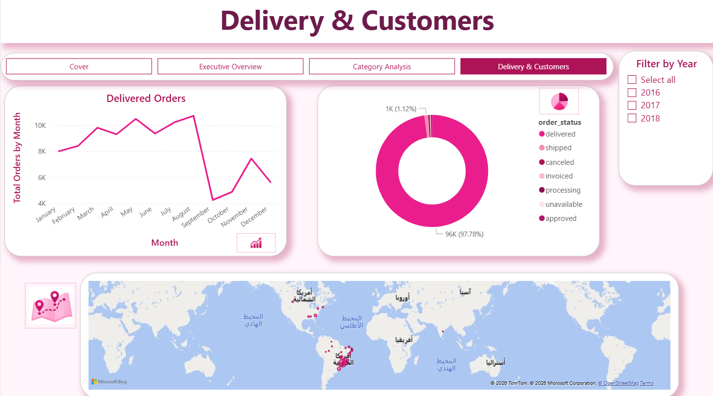
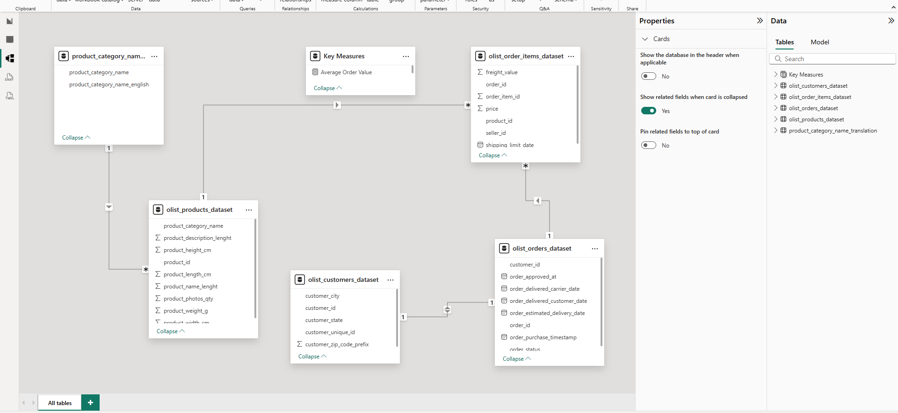

# Olist E-Commerce Analytics Dashboard

An end-to-end Power BI project that turns the Olist Brazilian e-commerce dataset into an interactive dashboard covering revenue, orders, product categories, delivery status and customer geography.


## Tools
Excel, Power Query, Excel Data Model, Power BI Desktop, DAX

## Workflow
1. **Download** the *Brazilian E-Commerce Public Dataset by Olist* from Kaggle (CSV files).
2. **Import** the CSV files into Excel with *Get Data* (one query and one sheet per file).
3. **Clean** each table in Power Query (promote headers, set data types, merge the category translation into the products table).
4. **Model** the data with the Excel Data Model and validate it with a PivotTable.
5. **Load** the workbook into Power BI, build the relationships and write the DAX measures.
6. **Design** the dashboard with a custom pink theme, page navigation and a year slicer.

## Dashboard pages







| Page | Content |
|---|---|
| Cover | Branded cover with the section menu |
| Executive Overview | Revenue, orders and average order value cards, revenue over time, revenue by product category |
| Category Analysis | Total categories, top category, category table, revenue by category |
| Delivery & Customers | Order status donut, orders over time, orders by customer state map |

## Data model (Power BI)


| From (one) | To (many) | Key |
|---|---|---|
| product_category_name_translation | olist_products_dataset | product_category_name |
| olist_products_dataset | olist_order_items_dataset | product_id |
| olist_orders_dataset | olist_order_items_dataset | order_id |
| olist_customers_dataset | olist_orders_dataset | customer_id (one-to-one) |

## Key measures (DAX)
```DAX
Total Revenue =
CALCULATE(
    SUM(olist_order_items_dataset[price]),
    olist_orders_dataset[order_status] = "delivered"
)

Total Orders = DISTINCTCOUNT(olist_order_items_dataset[order_id])

Delivered Orders =
CALCULATE(
    DISTINCTCOUNT(olist_order_items_dataset[order_id]),
    olist_orders_dataset[order_status] = "delivered"
)

Average Order Value = DIVIDE([Total Revenue], [Delivered Orders], 0)

Total Categories =
DISTINCTCOUNT(product_category_name_translation[product_category_name_english])

Avg Delivery Days =
AVERAGEX(
    olist_orders_dataset,
    DATEDIFF(olist_orders_dataset[order_purchase_timestamp],
             olist_orders_dataset[order_delivered_customer_date], DAY)
)
```
`Total Revenue` counts delivered orders only. `Total Orders` is left unfiltered on purpose because the status donut breaks it down by `order_status`.

## Repository structure
```
powerbi/   Power BI report (.pbix)
theme/     Custom Power BI theme (White_Pink_Full.json)
docs/      Full step-by-step documentation (English and Arabic, PDF)
assets/    Images used in this README
```

## Documentation
- [Project documentation (English)](docs/Olist_Project_Documentation_EN.pdf)
- [توثيق المشروع (العربية)](docs/Olist_Project_Documentation_AR.pdf)

## How to open
Open the `.pbix` file in Power BI Desktop. To refresh the data, point the Excel source to your own copy of the workbook built from the Kaggle CSV files.

## Data source
[Brazilian E-Commerce Public Dataset by Olist](https://www.kaggle.com/datasets/olistbr/brazilian-ecommerce) on Kaggle. The raw data files are not included in this repository.

## Author
**Lamiaa Mohamed**: Data Analyst
[LinkedIn](https://www.linkedin.com/in/lamiaa-mohamed-422770438) · [Kaggle](https://www.kaggle.com/lamiaamohamed2026)
